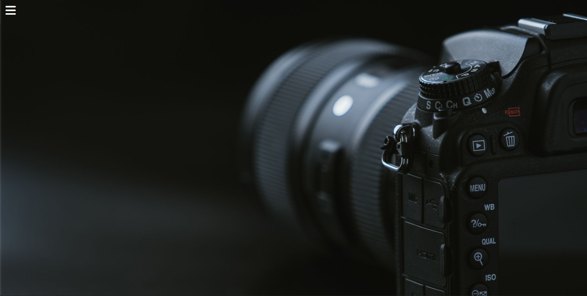
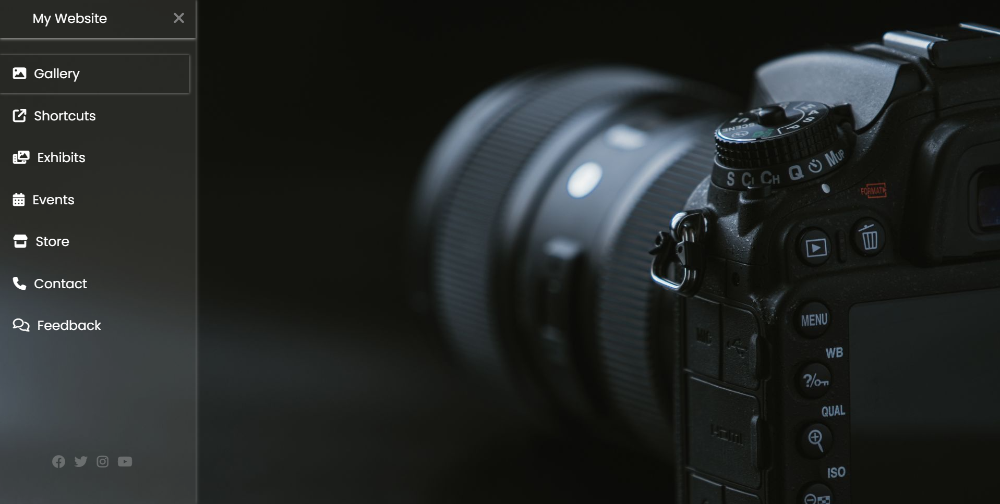

# CSS Sidebar Demo

A simple, full-screen photography landing page with a slide-out navigation sidebar. The menu opens and closes using a hidden checkbox and CSS sibling selectors, so the interaction needs no JavaScript.

## Preview

## Features

- Click the hamburger icon to open the sidebar; click the close icon to dismiss it.
- Navigation items and social icons have hover effects.
- Full-viewport camera photo background with a translucent sidebar.
- Built with HTML and CSS—no build tools or JavaScript required.

## Run locally

1. Download or clone this project.
2. Open `mini_index.html` in a browser.

The page loads Poppins from Google Fonts and icons from Font Awesome's CDN, so an internet connection is needed for those assets. The background photo and screenshots are stored locally in this folder.

## Project files

| File | Purpose |
| --- | --- |
| `mini_index.html` | Page structure and sidebar navigation |
| `mini_style.css` | Layout, background, sidebar animation, and hover styles |
| `camera_photo.jpg` | Full-screen background image |
| `SS1.png`, `SS2.png` | Closed and open menu previews |